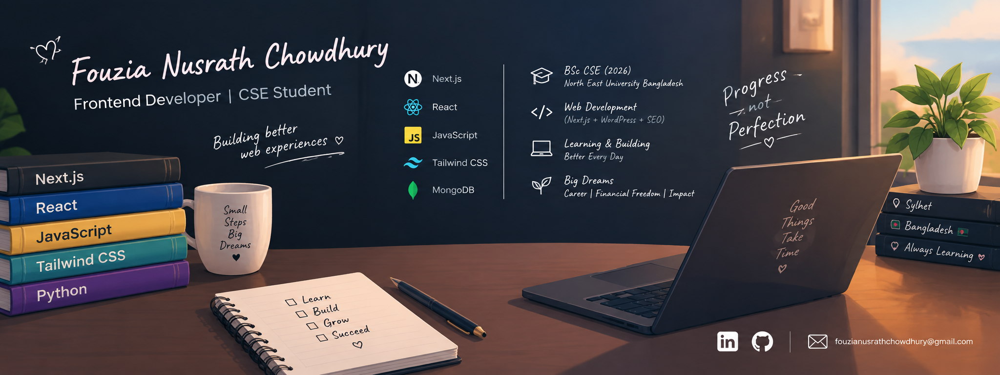

 

  

<h1 align="center">Hi, I'm Nusrath Chowdhury 👋</h1>

  <strong>CSE Graduate • Software Developer in Progress • ML/NLP Researcher</strong>

  Currently learning, building, and improving my skills in
  <strong>Software Development, Web Development, and Machine Learning</strong>.

  
  
  

---

## 👩‍💻 About Me

- 🎓 CSE Graduate from **North East University Bangladesh**
- 💻 Currently learning and growing as a **Software Developer**
- 🌐 Interested in **Web Development and Software Engineering**
- ⚛️ Building projects with **React, Next.js, TypeScript, and Tailwind CSS**
- 🧩 Currently improving my **JavaScript problem-solving skills**
- 🤖 Background in **Machine Learning, Deep Learning, and NLP**
- 🌾 Working on research related to **Bangla crop disease detection**
- 📚 Learning through projects, coding practice, and continuous development
- 🚀 My goal is to build useful, reliable, and real-world software

---

## 🎯 What I'm Currently Learning

  
  
  
  
  
  
  

---

## 🛠️ Tech Stack

### 🌐 Frontend Development

  

### ⚙️ Backend & Database

  

### 🤖 Machine Learning & Data Science

  

  
  
  
  

### 🧰 Tools & Platforms

  

---

## 🚀 Featured Projects

<table>
  <tr>
    <td width="50%">
      <h3>🏋️ FitLog</h3>
      
A modern workout library and workout planning application built while practicing <strong>Next.js, React, TypeScript, Tailwind CSS, and API integration</strong>.

      
<strong>Technologies:</strong>

      

        <code>Next.js</code>
        <code>React</code>
        <code>TypeScript</code>
        <code>Tailwind CSS</code>
        <code>API</code>
      

    </td>
    <td width="50%">
      <h3>📚 Book Vibe</h3>
      
A book discovery and reading-list application built with <strong>Next.js and React</strong>, including book details, reading lists, wishlist functionality, and shared application state.

      
<strong>Technologies:</strong>

      

        <code>Next.js</code>
        <code>React</code>
        <code>Context API</code>
        <code>Dynamic Routes</code>
        <code>JSON</code>
      

    </td>
  </tr>
  <tr>
    <td colspan="2">
      <h3>🌾 Bangla CropAssist</h3>
      
<strong>Bangla CropAssist: Symptom-Based Multi-Crop Disease Detection with Treatment Guidance</strong>

      
A research project focused on identifying crop diseases from Bangla symptom descriptions and providing treatment guidance.

      
<strong>Technologies:</strong>

      

        <code>Bangla NLP</code>
        <code>BanglaBERT</code>
        <code>LSTM</code>
        <code>Machine Learning</code>
        <code>Deep Learning</code>
      

    </td>
  </tr>
</table>

---

## 📊 GitHub Overview

  

  
  

---

## 📈 GitHub Statistics

  
  

---

## 🔥 Contribution Activity

  

  <a href="https://github.com/NusrathChowdhury?tab=overview">
    View my contribution calendar and activity on GitHub
  </a>

---

## 📦 GitHub Activity

  
  

---

## 🎯 My 2026 Goals

- 🚀 Grow as a Software Developer
- 💻 Build more real-world projects
- 🧩 Improve problem-solving and DSA skills
- ⚛️ Become stronger with React and Next.js
- 🔧 Improve backend development skills
- 🌱 Start contributing to open-source projects
- 📚 Continue learning Machine Learning and NLP
- 🛠️ Build a stronger GitHub portfolio

---

## 📫 Let's Connect

  
  
  

  <i>Learning • Building • Improving • One project at a time 🚀</i>

